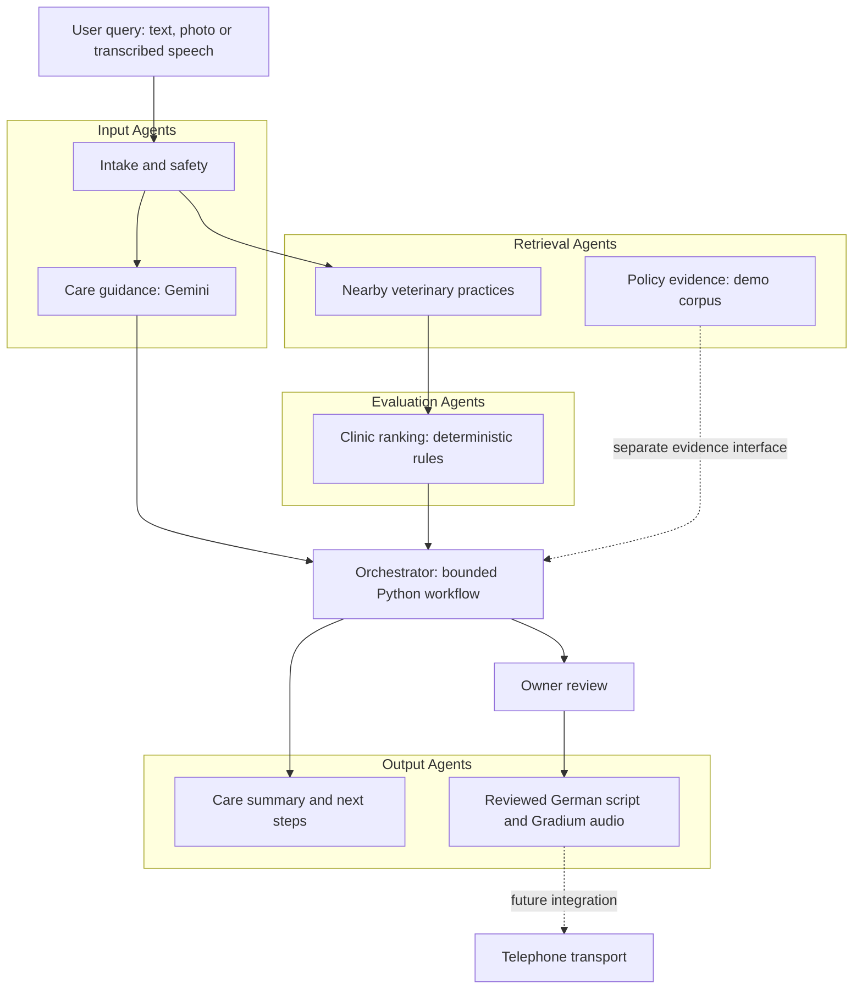

# Pawse 🐾

> A multi-agent cat-care assistant that turns a worried moment into clear next steps, nearby veterinary care, and a conversation in the local language.

[Local Demo](http://127.0.0.1:8765) · [API Docs](docs/API_CONTRACT.md) · [Architecture](docs/ARCHITECTURE.md)

[](LICENSE)
[](docs/SPEC.md)
[](docs/HACKATHON.md)

---

## Overview

Pawse brings cat-care guidance, veterinary discovery, insurance information and multilingual communication into one app.

An owner can describe a concern in their own language, attach a photo, and prepare the details a veterinarian needs. The system retrieves nearby practices, explains available next steps, and drafts a German call script with subtitles. Gradium integration supports generating that script in an owner-consented voice.

The initial experience is centred on Zurich, Switzerland. Pawse is built specifically for the **Tech Europe AI Hackathon, sponsored by Google DeepMind**, as described by the project team. It is an independent participant project. The imported CatAgent backend predates the hackathon; the unified interface and new integrations are documented in the [source import review](docs/IMPORT_REVIEW.md).

---

## System

Pawse uses a bounded multi-agent workflow:

**User Input → Intake & Safety → Care Guidance + Clinic Retrieval → Ranking → Case Coordination → Reviewed Script & Audio**

Care guidance and clinic retrieval run concurrently. The coordinator combines available results, preserves missing information, and reports each agent's execution state. Policy evidence is available through a separate retrieval interface, currently limited to a fictional demo corpus.

Model-based understanding is separated from deterministic ranking, cost calculations and execution control. The current coordinator is implemented in Python; it does not add a second reasoning-model call. This structure supports observable results, explicit API boundaries and useful partial responses when a provider is unavailable.

---

## Key Capabilities

- Text, photo and recorded-audio intake, with English, Mandarin Chinese, German and Hindi input options.
- Structured care guidance, warning-sign handling and questions to prepare for the vet.
- Nearby veterinary search through independent MapifyAI or Google Places adapters.
- Explainable clinic ranking using reported opening status, distance and rating.
- Policy-clause retrieval with source references and document hashes, using synthetic demo evidence.
- German scripts with paired subtitles, own-voice recording, and Gradium cloning/localization adapters.
- Agent execution traces, care-request SSE progress and partial-result handling.
- A bridge to existing CatAgent chat and analysis capabilities, subject to their runtime dependencies.

---

## Demo

Run the app locally and open [Pawse](http://127.0.0.1:8765) to try **Mimi's two-minute story**:

1. Mimi is limping after jumping from a wardrobe.
2. Pawse prepares a German vet conversation with English subtitles.
3. The insurer explains the deductible and the services the policy does not cover.
4. The owner compares a clinic visit at an estimated **CHF 385** with a home visit at **CHF 510**.
5. The rehearsal ends with a taxi request and a case/claim checklist.

Calls, replies, calendar slots, coverage and prices in this story are simulated. The estimates use a [demo policy](research/pet-insurance/README.md) on real Swiss pet-insurance terms (AVB, December 2025); the policyholder and schedule are synthetic. The live interface currently accepts photos and recorded audio; the story's video intake is not connected.

---

## Architecture

The system consists of:

- A responsive web interface with Mapify-inspired pink and gray styling.
- A FastAPI backend with bounded asynchronous agent coordination.
- Gemini adapters for care guidance, audio understanding and translation.
- Gradium adapters for voice cloning, German localization and speech generation.
- Clinic-provider adapters and a local, citation-bearing policy retrieval module.



See [Architecture](docs/ARCHITECTURE.md) for execution boundaries, [Agent Development](docs/AGENT_DEVELOPMENT.md) for module contracts and feature branches, and [Model Allocation](docs/MODEL_ALLOCATION.md) for project-specific access checks.

---

## Quick Start

Python **3.11+**:

```sh
python3 -m venv .venv
source .venv/bin/activate
pip install -r requirements.txt
# Create local configuration if it does not already exist.
cp -n .env.example .env
# Fill in the relevant server-side settings, then start the app.
uvicorn pawse.app:app --host 127.0.0.1 --port 8765
```

App: [localhost:8765](http://127.0.0.1:8765) · Swagger UI: [localhost:8765/docs](http://127.0.0.1:8765/docs)

| Setting | Purpose |
| --- | --- |
| `GEMINI_API_KEY` | Care guidance, transcription and translation |
| `GEMINI_MODEL` | Default model: `gemini-3-flash-preview`; optional care/voice overrides are documented in `.env.example` |
| `GRADIUM_API_KEY` | Voice cloning, localization and German audio |
| `GRADIUM_VOICE_ID_DE` | Optional approved German voice to reuse across restarts |
| `MAPIFY_BASE_URL` or `GOOGLE_PLACES_API_KEY` | Live clinic search; Places requires separate API access |
| `LEGACY_AGENT_BASE_URL`, `LEGACY_AGENT_USER_ID`, `LEGACY_AGENT_CAT_IDS` | Optional connection to the existing CatAgent backend |

The story rehearsal and local demo-policy search work without provider keys. See the [voice guide](docs/VOICE_CONCIERGE.md), [Mapify adapter](docs/MAPIFY_ADAPTER.md) and [API contract](docs/API_CONTRACT.md) for integration details.

Run the automated checks with `pip install -r requirements-dev.txt` followed by `pytest -q tests`. Tests use mocked providers; live model access checks are a separate opt-in script. See the [validation record](docs/VALIDATION.md).

---

## Limitations

This is a local hackathon prototype:

- Live clinic results require a configured provider. Unknown opening hours, services and insurance coverage remain unknown.
- Gradium adapters are contract-tested; real cloning and voice quality still need a configured key and an owner sample. Chinese and Hindi input use Gemini; Gradium output in this app is German.
- Telephone transport, calendar access, actual appointments, taxi bookings and claim submission are not connected. Dial links open a device dialer; generated audio is not injected into a phone call.
- Retrieval currently uses lexical search over the demo policy and an English adaptation of its terms. Real-policy ingestion and vector indexing are future work.
- Legacy device, report and knowledge services require their own configuration. Public multi-user hosting needs authentication and durable ownership controls.

Pawse provides care navigation, not a diagnosis or a guarantee of treatment, coverage or response time. AI, location and voice sharing are separate opt-ins. Photos and recordings are not written to disk; care summaries expire from the local cache after 15 minutes. Gradium-created voices remain in the provider account until deleted. See [voice lifecycle details](docs/VOICE_CONCIERGE.md).

---

## Future Work

- Bidirectional phone conversations with recipient transcripts and owner-approved actions.
- Calendar integration and confirmed appointment workflows.
- Private policy ingestion, cited answers and evaluated Gemini embedding retrieval.
- Verified Zurich clinic data and broader multilingual speech evaluation.
- Authenticated integration of existing CatAgent device and reporting services.

---

## Contributors

See [Contributing](CONTRIBUTING.md) for contribution guidance and [Agent Development](docs/AGENT_DEVELOPMENT.md) for module boundaries, development branches and integration checks.

---

## License

[MIT](LICENSE). Built for the Tech Europe AI Hackathon. Third-party services, dependencies and excluded source materials are covered separately in [Third-party Notices](THIRD_PARTY_NOTICES.md).
