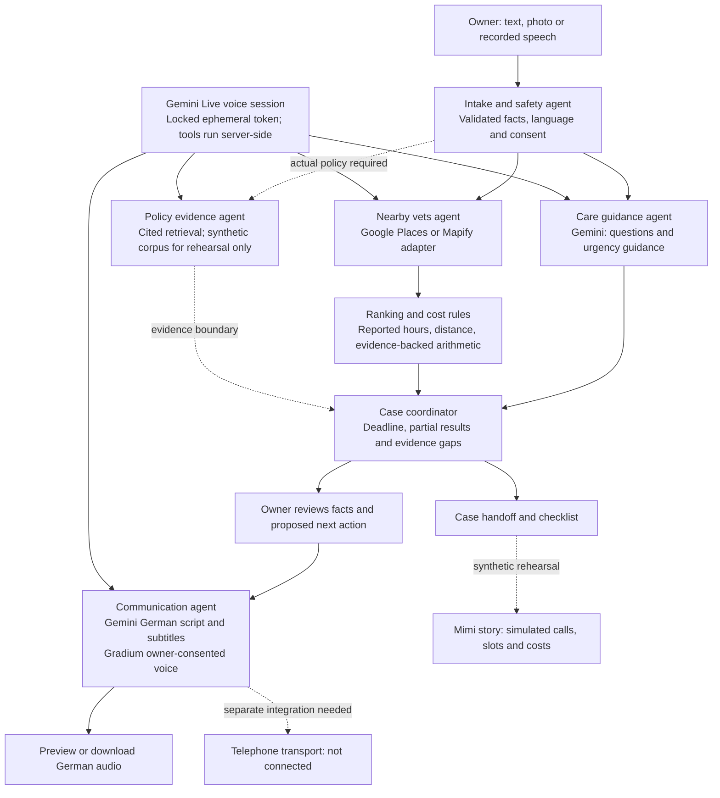

# Pawse agent architecture

Pawse uses a bounded workflow with seven named responsibilities. The model prepares language and care-navigation content; deterministic code handles consent, concurrency, evidence boundaries, arithmetic and action gates. Each role has a clear input and output, but a role does not require its own model, process or autonomous conversation.

The existing implementation already supports parallel care guidance and clinic retrieval. The agent layer makes that execution inspectable through a graph and per-run trace. The current coordinator is Python code, not a second reasoning-model call.


[Full-resolution PNG](images/pawse-multi-agent-architecture.png) · [Editable SVG](images/pawse-multi-agent-architecture.svg) · [Diagram notes](images/README.md)

<details>
<summary>Text-based flow reference (Mermaid)</summary>



Solid arrows show implemented flow or a separate implemented API step. Dashed arrows mark evidence boundaries, rehearsal-only data, or unconnected integrations. A draft script is never evidence that a telephone call happened.

</details>

## Current roles

| Runtime role | Implementation | Module | Current behavior |
| --- | --- | --- | --- |
| Intake and safety | Validated models and rules | LLM backend | Text/photo input, explicit data-sharing flags and immediate reported-warning-sign guidance; recorded speech has a separate transcription endpoint. |
| Care guidance | Gemini model | LLM backend | Structured care-navigation summary, questions and services to ask about; no diagnosis or treatment guarantee. |
| Nearby veterinary practices | External data adapters | RAG/data backend | Provider-backed clinic names and contacts; opening hours and services remain unknown unless supported. |
| Policy evidence | Local retrieval tool | RAG/data backend | Cited synthetic insurance clauses for rehearsal; no live customer coverage decision. |
| Ranking and cost rules | Deterministic functions | LLM backend | Clinic ranking; separate demo arithmetic for the fictional policy. Straight-line distance is not journey time. |
| Case coordinator | Bounded asynchronous Python workflow | LLM backend | Runs independent providers concurrently, retains partial results, exposes trace and action gates. |
| Multilingual communication | Gemini plus Gradium tools | Voice backend | Multilingual transcription, reviewed German scripts/subtitles, own-voice cloning and German audio adapters. Telephone transport is still unconnected. |

The frontend presents these agent outputs through a unified care interface.

## Executable contract

`GET /api/v1/agents/graph` reports each role's implementation, module ownership, configured model, dependencies and availability. A `configured_not_verified` value means an environment variable exists; it is not a live availability test. The project-specific model probes are in [model-access-check.json](model-access-check.json).

`POST /api/v1/agents/runs` accepts a nested existing `CareRequest`:

```json
{
  "care": {
    "query": "Mimi is limping after jumping from a wardrobe.",
    "cat_name": "Mimi",
    "language": "en",
    "location": {"lat": 47.3769, "lng": 8.5417},
    "share_with_ai": false,
    "share_location": false
  }
}
```

The response contains:

- `care`: the existing validated care result, with provenance and unknown fields preserved.
- `trace`: terminal states for all seven responsibilities, including skipped, timed-out and review-required work.
- `actions`: evidence and connection requirements for a script, coverage check, call, appointment, calendar entry and taxi.
- `external_actions_performed: false`: this endpoint never places calls or writes bookings.

The nested care result is cached under its `run_id` in the same session-scoped, 15-minute cache as `/care/requests`. It can be retrieved or deleted through `/care/requests/{id}`. The full trace is returned to the caller but has no separate history API. Both entry points share the provider coordinator and a five-request concurrency pool; use the original care endpoint for SSE progress.

The provider coordinator has a 40-second deadline; the agent wrapper has a 45-second outer deadline. Provider failures yield partial care navigation rather than fabricated results. This is an implementation budget, not a claim that real vet, insurer and taxi calls can finish in one minute.

## Evidence and actions

The live care workflow can retain a user-provided insurer contact, but it does not apply the fictional Mimi contract. Unknown policy terms, remaining deductible, actual clinic availability, transport fares and calendar availability must remain unknown. The Mimi story explicitly labels these as simulated.

Review and action states are part of the API. A future telephone connector must consume a reviewed recipient, purpose and script; record actual provider responses separately from model drafts; and require an owner decision before a binding booking. A future calendar connector must obtain calendar permission and use a confirmed appointment. None of these successes should be inferred from generated text.

For speech input, Gemini handles the app's English, Mandarin Chinese, German and Hindi routes. Gradium's documented language set is English, French, German, Spanish and Portuguese; the current app generates German output and offers localization of an owner-provided sample. Mandarin or Hindi input does not imply Gradium voice cloning supports those sample languages. Actual own-voice quality and multilingual recognition still need real, consented samples and a configured Gradium account.

## Validation boundary

The orchestration tests verify that care guidance and clinic discovery start concurrently, unknown hours remain unknown, partial guidance survives a deadline, provider exceptions are sanitized, consent prevents external processing, action gates remain unexecuted and the route enforces per-session concurrency. These tests use controlled provider responses. They do not verify real clinic opening hours, insurance coverage, call transport, multilingual accuracy or voice similarity.

See [Agent Development](AGENT_DEVELOPMENT.md) for module branches, the tested model matrix and the integration workflow.
